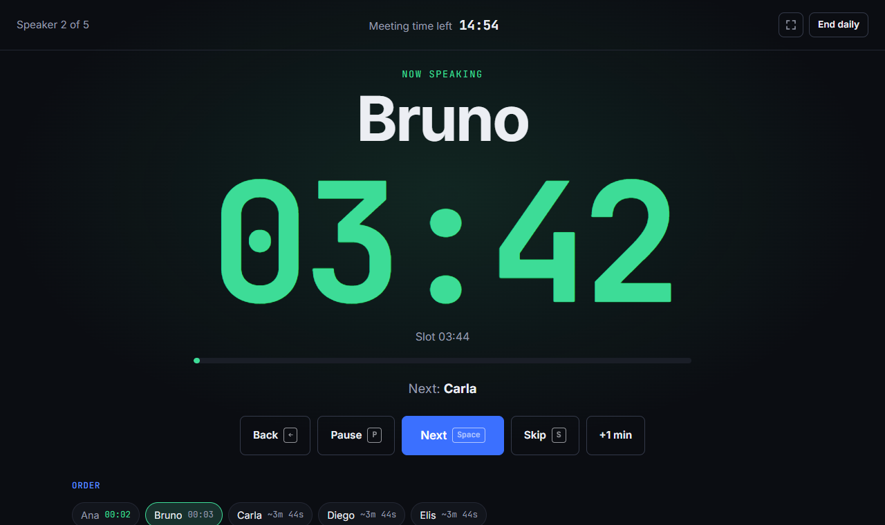
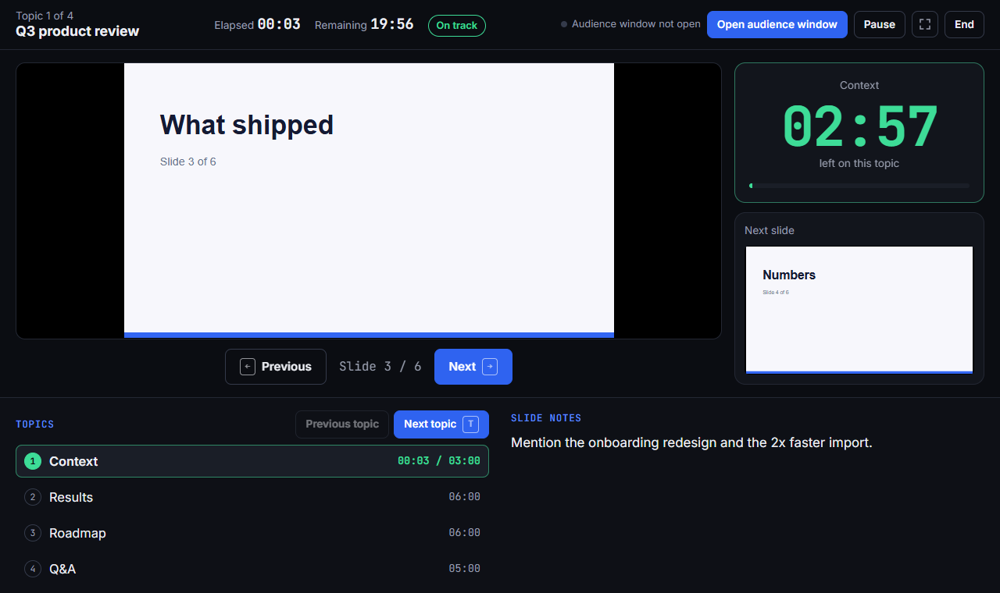
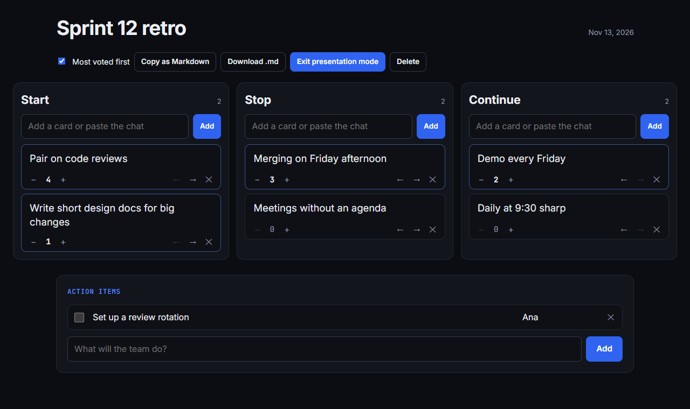
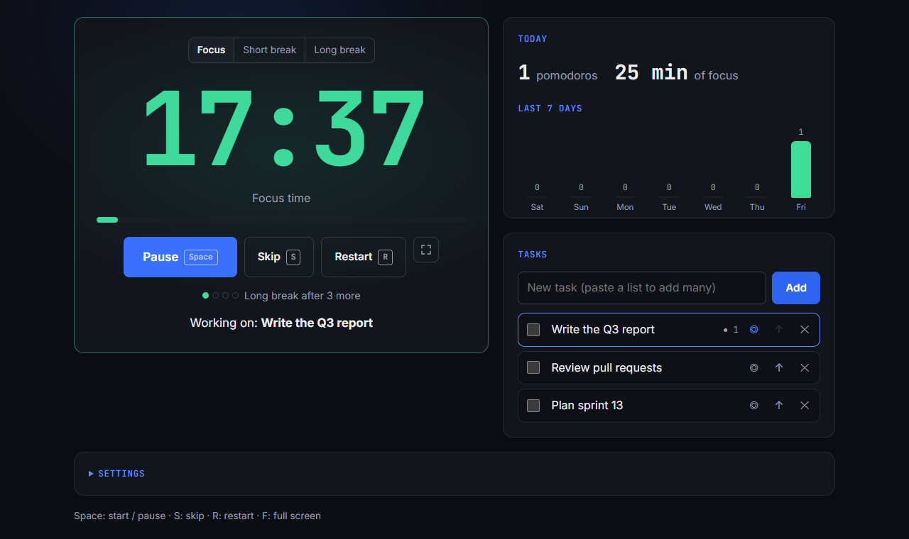

# Meeting Helpers

[](https://github.com/sapphire-labs-dev/meeting-helpers/actions/workflows/ci.yml)
[](LICENSE)

Free tools to keep meetings on time and focused: a **daily stand-up timer**, a **presentation timer**, a **retrospective board** and a **Pomodoro tracker**.
No sign-up, no server, no tracking: everything you type stays in your browser.

**Use it:** https://meet.sapphire-labs.dev · English and Portuguese · dark, light and pink themes

| Daily timer | Presentation timer |
|---|---|
|  |  |
| **Retrospective board** | **Pomodoro tracker** |
|  |  |

## Why

Stand-ups drift and talks run over because nobody can see the clock. Most meeting apps want an account, upload your slides or show ads. These tools do one job each, open instantly and keep your team names, notes and slides on your own computer.

## Features

**Daily timer** (`/daily`)
- Save teams once; mark who is absent today. Speaking order: shuffled, saved order or alphabetical.
- **Adaptive time** (default): each person's slot is the speaking time left divided by the people still waiting, so leftover time flows to the next people and overtime is taken from them. Or a **fixed** slot per person.
- Optional minutes reserved at the end for general topics; warning beep; skip / back / +1 min; late arrivals; summary.
- Keyboard: `Space`/`→` next · `←` back · `P` pause · `S` skip · `F` full screen. Reloading the page resumes the daily where it was.

**Presentation timer** (`/present`)
- Drop your slides as **PDF**, set the total time and the **topics** you will cover (with or without their own minutes), add private notes per slide.
- **Presenter view:** current and next slide, topic countdown, overall time, ahead/behind pace, notes. **Audience window** (`/present/screen`) shows only the slide; the two windows sync inside your browser.

**Retrospective board** (`/retro`)
- One person runs the board and shares the screen. The team sends their points in the call chat; paste the chat into a column and each line becomes a card.
- Formats: Went well / To improve, Start / Stop / Continue, Mad / Sad / Glad, the 4 Ls. Vote by show of hands (+ / −), sort by votes, move cards between columns.
- Action items with an owner; **copy as Markdown** or download a `.md` file for your wiki or ticket. Presentation mode hides everything but the board.

**Pomodoro tracker** (`/pomodoro`)
- Focus / short break / long break with configurable lengths; a long break every N focus sessions; optional auto-start, sound and browser notification.
- Task list: pick the task you are working on and it counts its pomodoros. Today's count and focus time, and the last 7 days.
- Keyboard: `Space` start/pause · `S` skip · `R` restart · `F` full screen. Timing survives a reload or a sleeping tab.

## Privacy

There is no backend. Settings, names, cards and notes live in `localStorage`; PDF files live in IndexedDB. Nothing is uploaded, fonts are served from the site itself, and there are no analytics or third-party requests. Clearing the site data in your browser deletes everything.

## Development

Requires **Node.js 22.23 or newer** (24 LTS recommended; see `.nvmrc`).

The layout, themes, shared components and browser helpers come from [`@sapphirelabs/ui`](https://github.com/sapphire-labs-dev/sapphire-ui). Until that package is published on npm, clone it next to this repository:

```
sapphirelabs/
  meeting-helpers/   ← this repository
  sapphire-ui/       ← git clone https://github.com/sapphire-labs-dev/sapphire-ui.git
```

```bash
npm install
npm run dev      # http://localhost:4321
npm run check    # type-check (also fails if a Portuguese translation is missing)
npm test         # unit tests (Vitest)
npm run build    # static site in dist/
npm run preview  # serve dist/ locally
```

### How the code is organised

Code is grouped by tool. Logic that can be tested without a browser (timers, time plans, reading saved data, Markdown export) is kept apart from the UI and has unit tests next to it.

```
src/
  pages/                   One page per route (/, /daily, /present, /present/screen, /retro, /pomodoro)
  layouts/Layout.astro     The shared SiteLayout with this site's name, menu and strings
  i18n/                    English / Portuguese strings per tool (PT must have every EN key)
  features/
    daily/                 session.ts (timer logic), teams.ts (saved teams), daily.ts + ui/ (views)
    present/               model.ts (time plan, pace, saved decks), stored.ts, present.ts + ui/ (views),
                           screen.ts (audience window), channel.ts, pdf.ts, files.ts (IndexedDB)
    retro/                 model.ts (board, votes, Markdown export, saved boards), retro.ts (page)
    pomodoro/              model.ts (phases, tasks, daily log, saved state), pomodoro.ts (page)
```

### Security

The site runs under a strict Content-Security-Policy generated at build time (`siteConfig()` from `@sapphirelabs/ui/config`), plus HTTP headers in `vercel.json`. Keep it that way: no inline scripts or `style` attributes in markup, no `innerHTML`, no third-party scripts, fonts or CDNs. See [SECURITY.md](SECURITY.md) to report a vulnerability.

## Contributing

Issues and pull requests are welcome. Before opening a PR, run `npm run check && npm test && npm run build` (CI runs the same). Keep the tools free of accounts and servers: if a feature needs a backend, open an issue first to discuss it. User-facing text needs both an English and a Portuguese string. Changes to the layout, themes or shared components belong in `@sapphirelabs/ui`.

## Deploy

It is a static site: import the repository into Vercel (Astro preset) or any static host and serve `dist/`. On hosts other than Vercel, set the headers from `vercel.json` yourself. If you use another domain, change `site` in `astro.config.mjs`.

## License and brand

The code is released under the [MIT License](LICENSE). The **Sapphire Labs** name and logo (shipped in `@sapphirelabs/ui`) are not covered by the license. If you publish a fork, please replace them and the links to sapphire-labs.dev with your own.
